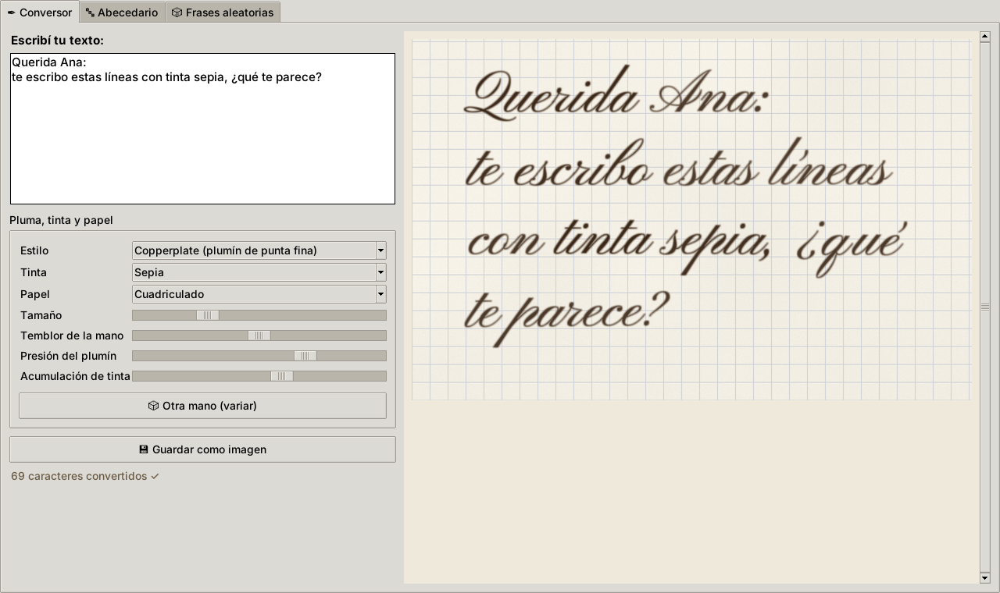
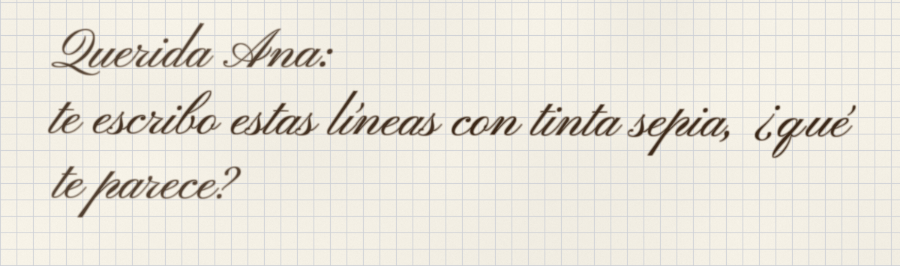
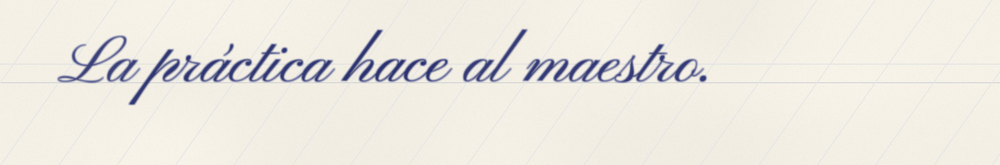
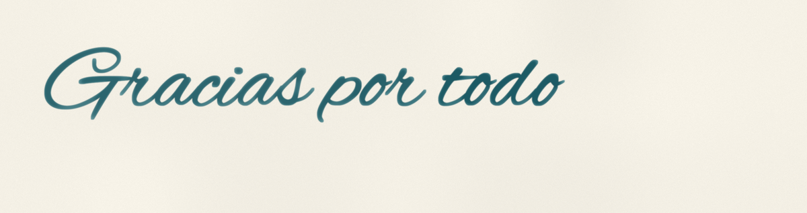
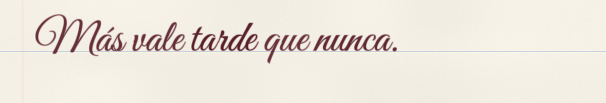

# Conversor Caligráfico ✒

Miniproyecto en Python: convierte cualquier texto escrito en computadora o celular en **letra caligráfica que parece escrita con una pluma real**.



## Descripción

Aplicación de escritorio (Tkinter) que muestra en tiempo real cómo quedaría un texto escrito a mano con plumín, pluma estilográfica o brush pen. No es solo una fuente cursiva: el motor simula la **mano** (línea base que ondula, letras levemente rotadas), la **tinta** (se acumula y oscurece en los trazos gruesos, deja un halo en el borde, cambia de carga entre palabras) y el **papel** (color crema, textura, cuadrícula o pauta).

## Características

- Conversión en tiempo real de texto normal a caligrafía simulada
- 3 estilos de pluma: Copperplate (plumín de punta fina), Cursiva inglesa (estilográfica) y Brush pen
- 6 tintas (Sepia, Negro hierro, Azul real, Turquesa, Burdeos, Verde bosque)
- 4 papeles: Cuadriculado, Rayado, Pautado caligráfico (con guías a 55°) y Liso
- Controles de temblor de la mano, presión del plumín y acumulación de tinta
- Botón "Otra mano" para volver a "escribir" el mismo texto con otras imperfecciones
- Soporte completo de español: Ñ, tildes, diéresis, ¿ ¡
- Exportación a PNG en alta resolución

## Estructura del Proyecto

La aplicación tiene tres pestañas (igual que las tres páginas del proyecto de referencia):

- **✒ Conversor** — escribís texto y ves el resultado caligráfico al instante
- **🔤 Abecedario** — tabla de referencia con todas las letras, acentos y números en el estilo elegido
- **🎲 Frases aleatorias** — genera frases para practicar caligrafía a mano

```
conversor-caligrafico/
├── app.py              # Interfaz gráfica (Tkinter): las 3 pestañas
├── motor.py            # Motor de renderizado (Pillow + NumPy), usable sin interfaz
├── frases.py           # Banco de frases para practicar
├── fonts/              # Fuentes caligráficas con licencia libre (OFL)
├── ejemplos/           # Imágenes de muestra
├── docs/
│   ├── analisis-socratico.md         # Análisis de diseño (método socrático)
│   └── agente-motor-caligrafico.json # Agente especializado para extender el motor
└── requirements.txt
```

## Cómo Usar

1. **Descargá el proyecto:** botón verde **Code → Download ZIP** y descomprimilo.
   (O con git: `git clone https://github.com/iesjoaco7-cyber/conversor-caligrafico.git`)
2. **Instalá Python 3.10 o superior** desde [python.org](https://www.python.org/downloads/).
   En Windows, marcá la casilla **"Add python.exe to PATH"** durante la instalación.
3. **Abrí una terminal en la carpeta del proyecto** (donde está `app.py`) e instalá las dependencias:
   ```bash
   python -m pip install -r requirements.txt
   ```
4. **Ejecutá la aplicación:**
   ```bash
   python app.py
   ```
5. Escribí en el cuadro de texto y observá cómo se convierte en letra de pluma.

> **Windows:** si aparece *"no se encontró Python"* o *"python no se reconoce"*, usá `py` en lugar de `python`
> (`py -m pip install -r requirements.txt` y `py app.py`).
>
> **Linux:** si falta Tkinter, instalalo con `sudo apt install python3-tk`.

También se puede usar desde la terminal, sin interfaz:

```bash
python motor.py "Hola, ¿cómo estás?" -o hola.png --estilo 2 --tinta Turquesa --papel Liso
```

| | |
|---|---|
|  |  |
|  |  |

## Cómo funciona el motor

1. **Forma:** cada letra se dibuja con una fuente caligráfica. Su posición se calcula con `getlength(palabra[:i])`, que incluye el *kerning*, para que las letras sigan enlazadas.
2. **Mano:** la línea base es una suma de dos senoidales con fase aleatoria (ruido *suave*, no saltos bruscos) y cada letra rota según la pendiente local de esa onda.
3. **Tinta:** la máscara de tinta se difumina para estimar el grosor del trazo; donde es grueso, la tinta es más opaca y oscura, y en el borde queda un halo (como la tinta de pluma al secarse).
4. **Papel:** color crema con textura de ruido y la pauta elegida.
5. Todo se dibuja al doble de resolución y se reduce con LANCZOS para bordes suaves.
6. Una **semilla** controla el azar: el mismo texto con la misma semilla da siempre la misma imagen.

## Tecnologías Utilizadas

- Python 3
- Tkinter (interfaz gráfica)
- Pillow (dibujo de texto e imágenes)
- NumPy (simulación de tinta)

## Créditos

Fuentes de Google Fonts bajo SIL Open Font License (ver `fonts/OFL.txt`): Pinyon Script, Great Vibes y Alex Brush.
Proyecto inspirado en la estructura de [JapaneseMiniProject](https://github.com/luedu1103/JapaneseMiniProject).
